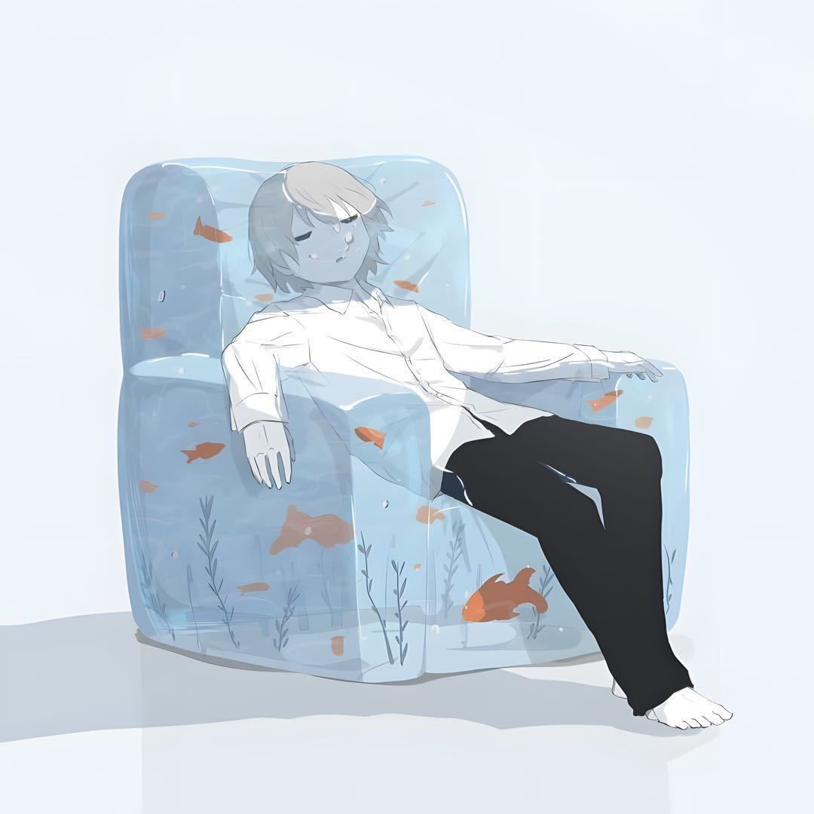
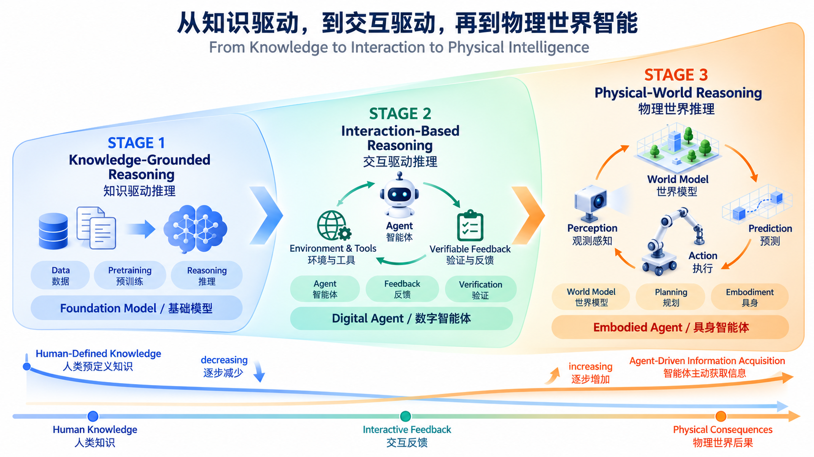

**Junjie Wang (王军杰)** is currently a **postdoctoral researcher** at the [IIGROUP Lab](https://iigroup.github.io/), [Tsinghua University](https://www.tsinghua.edu.cn/en/), supervised by [**Prof. Yujiu Yang**](https://iigroup.github.io/about/).
His research focuses on **Learning to Reason for Self-Evolving Agents**, spanning knowledge-grounded reasoning in foundation models, interaction-based reasoning in digital agents, and physical-world reasoning in embodied agents. He received his Ph.D. in Engineering from [Waseda University](https://www.waseda.jp/top/en/), under the supervision of [**Prof. Tetsuya Sakai**](http://sakailab.com/tetsuya/).

Email: wangjunjie@sz.tsinghua.edu.cn (**Please state your purpose / 请您注明来意**)

📰 **News / 最近**

- [09/2026] 📜 3 papers are accepted to NeurIPS 2026!
- [08/2026] 📜 8 papers are accepted to EMNLP 2026 !
- [06/2026] 🏅 Selected as an ICML 2026 Golden Reviewer.
- [04/2026] 📜 1 paper is accepted to ICML 2026 !
- [04/2026] 📜 2 papers are accepted to ACL 2026 !
- [03/2026] 📜 1 paper is accepted to TMLR ! 获选CAAI-腾讯犀牛鸟研究计划 !
- [01/2026] 🎉 ROCO@AAAI2026 决赛冠军: [URL](https://wangjunjie-ai.github.io/portfolio/8-roco/)
- [01/2026] 📜 1 paper is accepted to ICLR 2026 !
- [11/2025] 📜 1 paper (Oral) is accepted to AAAI 2026 !

🌌 **Research Vision / 研究愿景**

Learning to Reason: From Knowledge to Interaction to Physical Intelligence

学会推理：从知识驱动，到交互驱动，再到物理世界智能

My central question is: **How can reasoning become a continually improving capability?** I study a progression from knowledge-grounded reasoning to interaction-based reasoning and physical-world reasoning, with decreasing reliance on human-defined knowledge and increasing agent-driven information acquisition.

我的核心问题是：**如何让推理成为一种能够持续改进的能力？** 我关注从知识驱动推理、交互驱动推理到物理世界推理的演进：对人类预定义知识的依赖逐步减少，智能体通过交互主动获取信息的能力逐步增强。

  

<em>From foundation models to digital agents and embodied agents: human knowledge → interactive feedback → physical consequences. 从基础模型，到数字智能体，再到具身智能体：人类知识 → 交互反馈 → 物理世界后果。</em>

🧭 **Three Stages of Reasoning / 推理的三个阶段**

1. **Knowledge-Grounded Reasoning / 知识驱动推理** — Develop reasoning capabilities in foundation models through pretraining on human-curated data and knowledge. 
   通过在人类整理的数据与知识上进行预训练，发展基础模型的推理能力。

2. **Interaction-Based Reasoning / 交互驱动推理** — Enable digital agents to actively acquire information through environments and tools, verify feedback, and turn interaction experience into capability improvements. 
   让数字智能体通过环境与工具主动获取信息、验证反馈，并将交互经验转化为能力提升。

3. **Physical-World Reasoning / 物理世界推理** — Enable embodied agents to connect perception, world modeling, prediction, and action, using planning and physical consequences to inform subsequent decisions. 
   让具身智能体将感知、世界建模、预测与行动形成闭环，通过规划指导行动，并根据物理世界中的行动后果调整决策。

🔄 **Toward Reasoning-Centric RSI / 迈向以推理为中心的 RSI**

**Interaction → Verification → Attribution → Internalization → Capability Improvement ↺**

My long-term goal is **Reasoning-Centric Recursive Self-Improvement (RSI)**: agents that can verify which experiences are trustworthy, attribute success and failure, internalize high-value lessons, and eventually improve the mechanisms by which they improve.

我的长期目标是构建**以推理为中心的递归自我改进（Reasoning-Centric RSI）**：让智能体能够验证经验、归因成败、内化高价值反馈，并最终改进其自身的改进机制。

✒️ **Recent Professional Services / 最近的专业服务**

- Golden Reviewer: ICML 2026
- Area Chair: ACL ARR 2025 October (EACL); ACL ARR 2026 January (ACL); ACL ARR 2026 March (EMNLP).
- Senior PC member: WSDM 2026
- Workshop Organiser: [SIGIR-AP 2025 BREV-RAG Workshop](https://dl.acm.org/doi/10.1145/3767695.3769523)

## Publications

Details in [Publications Page](https://wangjunjie-ai.github.io/publications/)

Total Publications: {{ site.publications | size }}

- ⭐: Co-first Author
- 🚩: Corresponding Author
- 💭: Under Review

<ul>
  
</ul>
