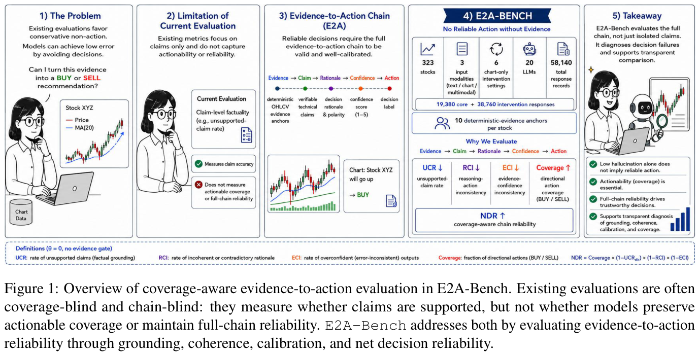
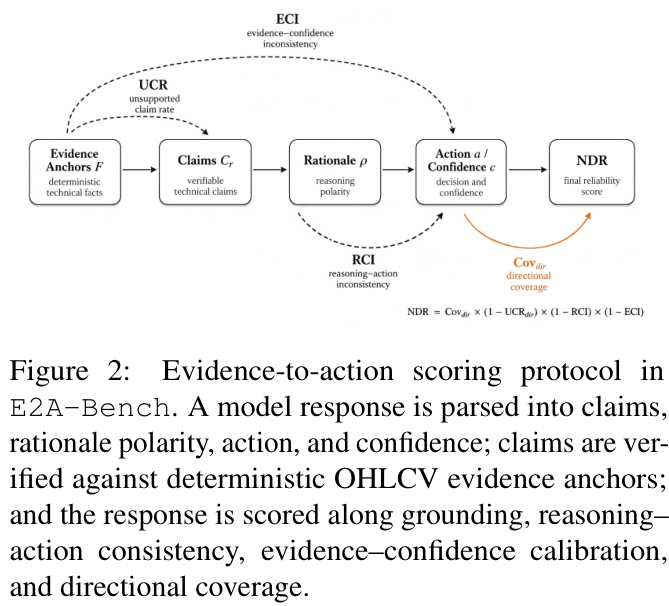
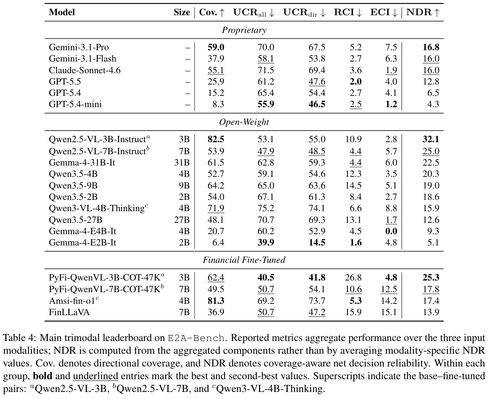

EMNLP 2026 Findings: [E2A-Bench: Benchmarking Evidence-to-Action Reliability in Financial Chart Reasoning](https://aclanthology.org/2026.findings-emnlp.450/)

代码与数据：[https://github.com/wanng-ide/E2A-Bench](https://github.com/wanng-ide/E2A-Bench)

## 1. 关键词 (Keywords)

* 金融图表推理 / Financial Chart Reasoning
* 视觉语言模型 / Vision-Language Models
* 证据到行动 / Evidence-to-Action
* 幻觉与证据支撑 / Hallucination and Grounding
* 推理—行动一致性 / Reasoning–Action Consistency
* 证据—置信度校准 / Evidence–Confidence Calibration
* 方向性覆盖率 / Directional Coverage
* 净决策可靠性 / Net Decision Reliability (NDR)

## 2. 背景与动机 (Background & Motivation)

金融图表分析不仅需要模型描述价格、成交量或技术指标，还要求其推理理由、置信度和最终建议与可核验的图表证据一致。仅统计输出中有多少无依据主张，无法判断证据是否贯穿了整条决策链。

另一个问题是**覆盖率陷阱**：模型可以通过回避可核验主张或长期输出 HOLD，减少观察到的无依据主张，但这不意味着它能形成有依据的方向性建议。E2A-Bench 因此将评测对象从单条主张扩展到「证据 → 主张 → 理由 → 置信度与行动」，同时检查方向性覆盖率。

  

**Figure 1** 概述了以覆盖率和证据支撑共同衡量可靠性的评测思路。

## 3. 核心方法 (Core Methodology)

### 从图表事实到完整决策链

论文对每个 30 个交易日的 OHLCV 窗口，用固定规则计算 10 类证据锚点，覆盖均线、价格突破、趋势、波动率、量价关系和短期动量等。模型输出被解析为技术主张、推理方向、行动（BUY、SELL、HOLD 或 UNCERTAIN）和 1–5 的置信度，再按锚点核验。

这些锚点是**图表事实，不是标准交易动作**；基准不依据未来收益判定 BUY 或 SELL 是否正确，而是检查模型给出的建议是否与可验证证据一致。

  

**Figure 2** 将局部诊断与方向性覆盖率连接起来：

* **UCR（Unsupported Claim Rate）**：先计算每条响应中无证据支持的技术主张占可核验技术主张的比例，再对响应取平均；`UCR_all` 覆盖所有响应，`UCR_dir` 只统计方向性响应。没有提取到可核验主张时该响应按约定记为 0，不能因此视为可靠决策。
* **RCI（Reasoning–Action Consistency Inconsistency）**：推理方向与最终方向性行动直接矛盾的比例，即看涨却卖出或看跌却买入；中性或未知推理方向不自动计为矛盾。
* **ECI（Evidence–Confidence Inconsistency）**：没有强信号时仍给出高置信度方向性行动的比例，论文使用置信度至少为 4 的条件。
* **Coverage**：产生 BUY 或 SELL 的响应比例；更严格的阈值设置还要求达到最少强信号数。
* **NDR（Net Decision Reliability）**：主设置下为 `Coverage × (1 − UCR_dir) × (1 − RCI) × (1 − ECI)`。RCI 和 ECI 默认在方向性响应上统计。

NDR 衡量覆盖率约束下的证据到行动可靠性，**不是实际投资收益或交易回测表现**；其乘法形式也不意味着各因素相互独立。

## 4. 实验设计 (Experimental Design)

完整研究包含 **323 只沪深 300 成分股、969 条查询**，即每只股票分别对应 text-only、chart-only 和 multimodal 三种输入；10 类锚点共形成 **3,230 条事实**。论文评测 20 个闭源、开源及金融微调视觉语言模型，并对自动评分器开展人工验证。

论文完整研究与公开材料范围不同：公开仓库提供 **100 张图表、100 条评测事实记录及 300 条三模态查询元数据**。当前材料可直接评测 100 条 chart-only 查询；text-only 和 multimodal 的原始文本输入未包含在公开包中。

## 5. 实验结果与分析 (Results & Analysis)

### 幻觉分数与方向性覆盖率

  

**Table 4** 汇总三种输入模态，NDR 由汇总后的指标计算，而不是各模态 NDR 的简单平均：

* Gemma-4-E2B-It 的 `UCR_all` 最低，为 **39.9%**，但方向性覆盖率仅 **6.4%**，NDR 为 **5.1%**。
* Qwen2.5-VL-3B-Instruct 的方向性覆盖率为 **82.5%**，NDR 达到 **32.1%**，是表中最高值。
* 金融微调模型 PyFi-QwenVL-3B-COT-47K 的 NDR 为 **25.3%**，但 RCI 为 **26.8%**，反映出不同可靠性维度之间的权衡。

这些结果说明，低无支持主张率可能与保守不行动同时出现；评价方向性建议时需要同时查看覆盖率和各环节质量。

### 输入模态与金融微调

在 20 个模型的基线结果中，chart-only、text-only 和 multimodal 的平均 NDR 分别为 **19.2%、14.5% 和 15.6%**。模态效果因模型而异，这些平均数也不同于主表先汇总组件再计算的三模态 NDR。

对三个严格匹配的基础模型—金融微调模型配对，论文观察到 BUY:SELL 比例增加 **4.21–4.68 倍**，而 NDR 变化方向并不一致。这是对输出分布变化的描述；由于微调语料与目标并非完全公开，不能据此确定造成偏移的原因。论文还发现，在 chart-only 干预实验中，oracle 辅助核验虽可减少无支持主张，却可能显著压低方向性覆盖率。

## 6. 总结与贡献 (Conclusion & Contribution)

E2A-Bench 提供可复现的图表事实锚点和覆盖率感知评测，将证据支撑、推理—行动一致性、置信度校准及行动覆盖连接为一条可诊断的证据链。实验证明，单一主张级幻觉分数可能掩盖不行动或行动偏向等问题。

评测结论限定于论文的数据、模型、输出解析和证据规则；它不赋予交易动作标准答案，也不衡量真实收益。
