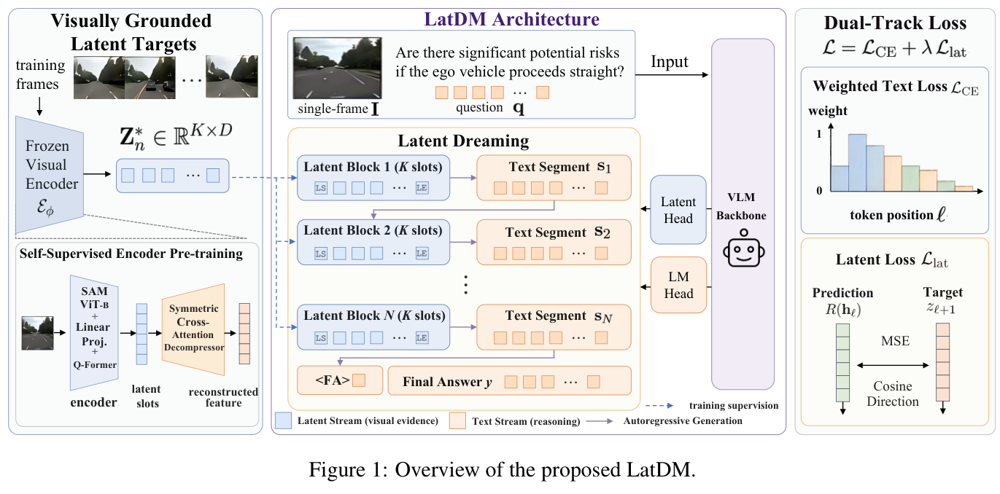
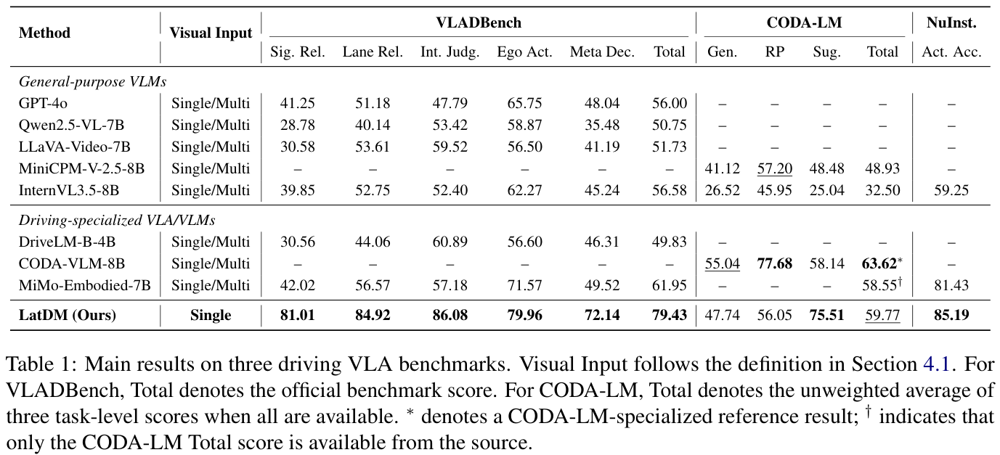
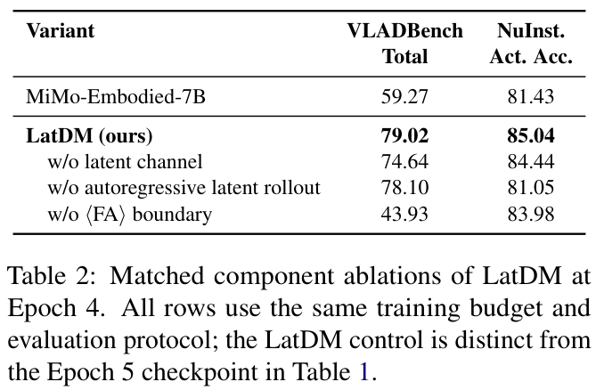

EMNLP 2026 Findings: [Latent Dreaming: Let Language Think Yet Latent See in Driving VLA](https://aclanthology.org/2026.findings-emnlp.401/)

## 1. 关键词 (Keywords)

* 自动驾驶视觉语言行动模型 / Driving Vision-Language-Action (VLA)
* 潜在推理 / Latent Reasoning
* 文本思维链 / Textual Chain-of-Thought
* 视觉证据 / Visually Grounded Evidence
* 自回归生成 / Autoregressive Generation
* 双轨监督微调 / Dual-Track Supervised Fine-Tuning

## 2. 背景与动机 (Background & Motivation)

自动驾驶决策需要理解道路规则和参与者意图，也依赖车道关系、运动趋势等连续的空间与时间信息。文本思维链便于表达抽象推理和解释决策，但让文本承担全部中间视觉证据，可能丢失对行动有用的细节。

论文通过隐藏状态探针和文本解码比较这一问题。在 NuInstruct 的六摄像头多帧诊断中，MiMo-Embodied-7B 的隐藏状态线性探针准确率为 **93.2%**，贪心文本解码为 **72.0%**。这一差距说明文本输出未恢复全部可线性读取的决策信息，但不能单凭这一诊断认定词表投影是错误的唯一原因。

论文因此提出 **Latent Dreaming（LatDM）**：让连续潜在状态承载视觉信息，让文本负责语义抽象、交通规则与决策表达，在同一推理过程中交替使用两种表示。

## 3. 核心方法 (Core Methodology)

  

**Figure 1** 展示了三个阶段及两种互补通道：

1. **视觉编码器预训练**：基于 SAM ViT-B 和跨注意力模块，在约 20.9 万张无标注驾驶帧上自监督训练，将每帧压缩为 16 个连续向量；之后冻结编码器，用其输出提供潜在监督。
2. **双轨监督微调**：在 MiMo-Embodied-7B 上使用 LoRA，将潜在块与文本推理段交替排列。潜在回归头以冻结编码器输出为目标，结合均方误差与余弦方向损失；语言头学习文本推理及最终答案。
3. **混合模式推理**：边界 token 控制模型在文本生成和连续潜在向量生成之间切换，最后输出文本答案。文本可使用前面的潜在状态，后续潜在块也可利用已有的文本和潜在上下文。

训练与推理的区别尤其重要：顺序训练样本中的后续帧只用于生成潜在监督目标；训练先进行 teacher-forcing 预热，再在块内自回归展开，且该阶段每个块的首个槽位仍锚定真实潜在目标。推理时模型只接收第一帧和问题，自行生成后续潜在状态，**不需要测试时的真实未来帧或 oracle 潜在向量**。这些自生成状态是模型的内部假设，不应等同于真实未来观测。

## 4. 实验设计 (Experimental Design)

论文采用 53,672 条潜在—文本监督样本，评估三个驾驶任务：

* **VLADBench**：报告官方 Total 及感知、关系和决策等方面的分数。
* **CODA-LM**：报告一般感知、区域感知、驾驶建议，以及三者非加权平均的 Total。
* **NuInstruct**：报告预测动作与参考动作一致的 Action Accuracy。

主表基线遵循各基准原有输入协议：CODA-LM 使用单帧，VLADBench 和 NuInstruct 使用多帧；LatDM 在三个基准上均只输入第一帧。因此主表比较包含输入协议差异，需要结合消融实验理解潜在通道的作用。

## 5. 实验结果与分析 (Results & Analysis)

### 三项基准的主结果

  

**Table 1** 中，LatDM 相对 MiMo-Embodied-7B 的 VLADBench Total 从 **61.95** 提升到 **79.43**，NuInstruct 动作准确率从 **81.43%** 提升到 **85.19%**；CODA-LM Total 从 **58.55** 提升到 **59.77**。CODA-LM 专项模型 CODA-VLM-8B 的 Total 为 **63.62**，高于 LatDM，但 LatDM 的驾驶建议分数为 **75.51**，是表中该项最高值。上述比较应结合表中不同输入协议和结果来源阅读。

### 潜在通道和生成机制的消融

  

**Table 2** 使用相同训练预算的第 4 个 epoch 检查组件，不能直接和主表第 5 个 epoch 的 LatDM 行混为一谈：

* 去除潜在通道，VLADBench Total 从 **79.02** 降至 **74.64**，NuInstruct 动作准确率从 **85.04%** 降至 **84.44%**，表明收益不完全来自文本微调。
* 去除块内自回归潜在展开，NuInstruct 降至 **81.05%**；去除最终答案边界及相应解码控制，VLADBench 降至 **43.93**。

### 隐藏状态与文本输出

在另一组双方均使用单帧的 NuInstruct 二分类诊断中，冻结 MiMo 的 Post-LLM 探针准确率为 **90.45%**，文本准确率为 **56.44%**；LatDM 分别为 **91.01%** 和 **76.19%**。探针结果变化较小，而文本读出提高，差距由 **34.01** 缩小至 **14.82** 个百分点。这是特定诊断设置下的结果，与前述六摄像头多帧诊断不能直接合并。

## 6. 总结与贡献 (Conclusion & Contribution)

LatDM 通过交替的连续潜在状态和文本推理，为驾驶 VLA 提供视觉证据与语言抽象互补的中间表示。论文给出自监督视觉目标、双轨训练和无需 oracle 的混合推理流程，并通过多基准与消融分析研究其作用。

该方法推理时仅观察首帧；对于长时程、严重遮挡或罕见动态场景，自生成潜在状态可能累积误差，仍需进一步验证。
