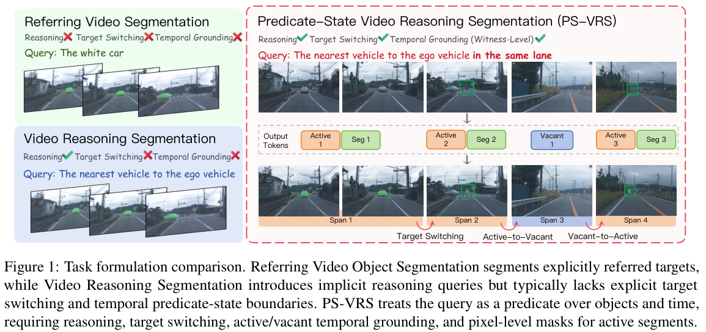
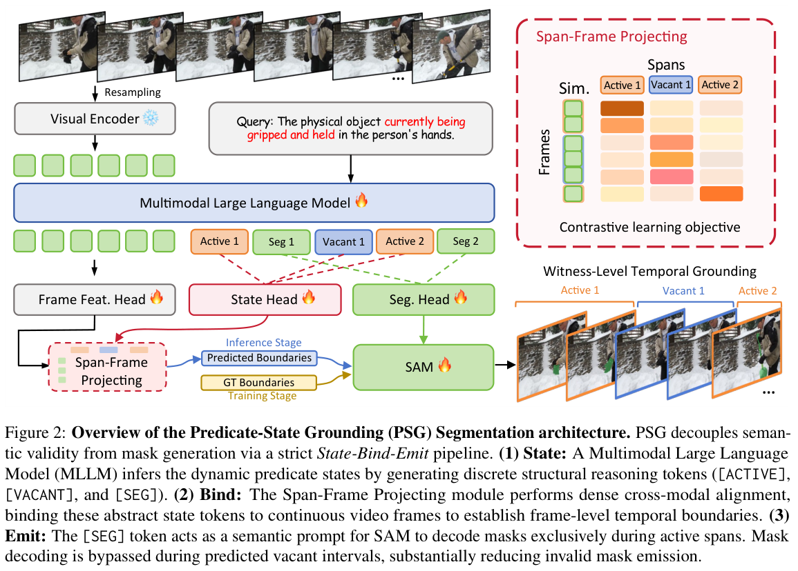
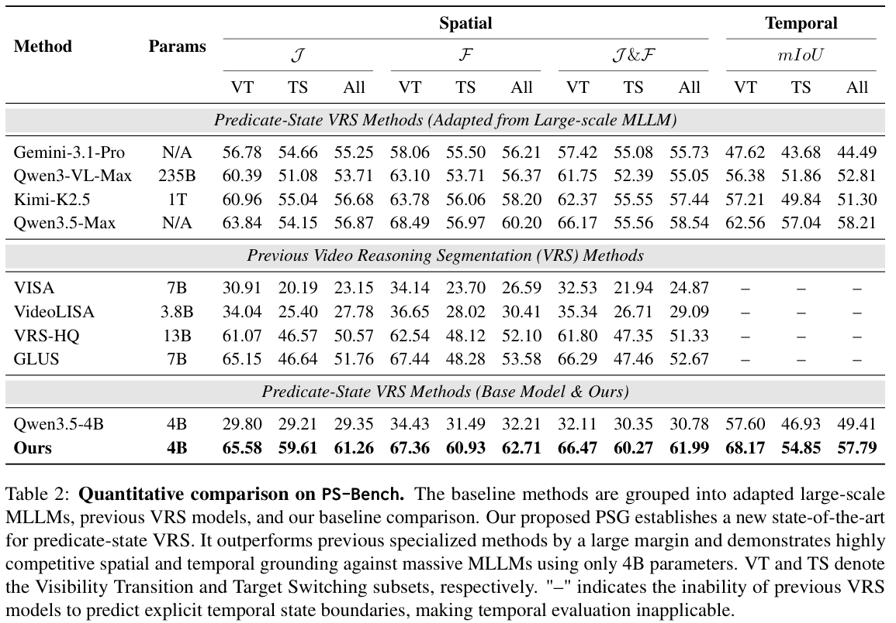
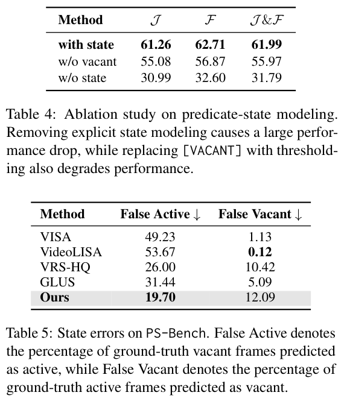
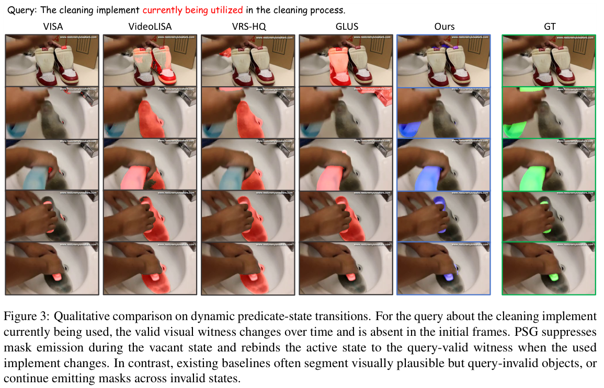

EMNLP 2026 Findings 论文：[https://aclanthology.org/2026.findings-emnlp.938/](https://aclanthology.org/2026.findings-emnlp.938/)

## 1. 关键词 (Keywords)

* 谓词状态视频推理分割 / Predicate-State Video Reasoning Segmentation (PS-VRS)
* 谓词状态定位 / Predicate-State Grounding (PSG)
* 动态视觉见证 / Dynamic Visual Witness
* 目标切换 / Target Switching
* 时间定位 / Temporal Grounding
* 活跃与空缺状态 / Active and Vacant States
* PS-Bench

## 2. 背景与动机 (Background & Motivation)

### 从固定目标到动态谓词

语言引导的视频分割通常先确定一个目标，再沿时间追踪它。但有些查询描述的不是固定身份，而是**随时间变化的条件**。例如，“同一车道中离自车最近的车辆”可能先后对应不同车辆；如果暂时没有满足条件的车辆，正确输出应为空，而不是继续分割画面中看起来相似的物体。

论文将查询表示为关于对象和时间的布尔谓词 `P_Q(o, t)`。在每个时刻，模型既要判断是否存在满足条件的视觉对象，也要在存在时分割当前对象。这里的**视觉见证**是当前满足查询条件的对象；它可以改变，也可以暂时不存在。

  

原文 **Figure 1** 展示了三种任务设定的区别：PS-VRS 同时要求推理、目标切换、状态区间定位和活跃区间内的像素分割。若只判断目标是否可见，就可能忽略“物体仍在画面中，但已不满足查询”的情况。

## 3. 核心方法 (Core Methodology)

### PS-VRS：预测状态、时间区间和掩码

对于视频与自然语言查询，PS-VRS 输出按时间排列的语义区间。每个区间标记为 **Active** 或 **Vacant**：前者包含满足谓词的视觉见证及其像素掩码，后者不存在有效见证，应输出空掩码。目标切换可以发生在相邻活跃区间之间，也可能经历空缺区间。

### PSG：State → Bind → Emit

  

原文 **Figure 2** 给出 Predicate-State Grounding (PSG) 的三个步骤：

1. **State：状态推理**。多模态大模型生成有序的 `[ACTIVE]`、`[VACANT]` 状态 token，并为每个活跃状态生成 `[SEG]` token。
2. **Bind：时间绑定**。将状态 token 表征与视频帧特征投影到共享空间，计算相似度；推理时按生成顺序比较相邻状态，确定连续、不重叠的时间区间。
3. **Emit：条件分割**。将活跃状态对应的 `[SEG]` 表征作为 SAM2 的提示，在该区间生成掩码；预测为空缺的区间直接输出空掩码。

训练联合使用语言生成、状态与帧对齐、活跃区间掩码监督。推理时按 1 fps 采样上下文帧，未采样帧继承最近上下文帧的状态；相邻状态的边界需经过连续帧窗口判断，以减少不稳定切换。这个设计将“是否满足查询”与“如何画掩码”拆开，但状态判断错误仍可能传递到后续分割。

## 4. 实验设计 (Experimental Design)

### PS-Bench

论文构建 **PS-Bench** 来评测动态谓词状态，包括 **2,077 个视频、16,250 条查询和约 157 万个掩码**。平均视频长度为 **45.81 秒**，每个样本平均有 **3.82 个语义区间**，其中 2.18 个活跃区间、1.64 个空缺区间。标注包括状态、时间区间、目标描述、推理信息以及活跃区间的像素掩码。

评测区分可见性转换（VT）与目标切换（TS）：VT 主要涉及目标进入或离开视野，TS 则涉及查询条件下的状态或目标身份变化。模型使用 Qwen3.5-4B 和 SAM2，并在 PS-Bench、MeViS 与 Ref-YouTube-VOS 的混合数据上训练；训练时上下文帧采样为 1 fps，活跃区间的掩码监督帧为 2 fps。

### 对比与指标

* **对比方法**：既有 VRS 方法 VISA、VideoLISA、VRS-HQ、GLUS，以及经过状态分段适配的大型多模态模型，例如 Gemini-3.1-Pro、Kimi-K2.5 和 Qwen3.5-Max。通用模型通过时间分段与框预测，再结合掩码生成进行比较。
* **空间指标**：`J` 衡量区域重叠，`F` 衡量边界质量，`J&F` 为两者均值。
* **时间指标**：对预测与真实状态区间进行贪心匹配，计算 temporal mIoU。既有 VRS 方法没有显式状态区间，因此表中不适用该指标。
* **状态错误**：False Active 是真实空缺帧被预测为活跃的比例；False Vacant 是真实活跃帧被预测为空缺的比例。

## 5. 实验结果与分析 (Results & Analysis)

### PS-Bench 主结果

  

原文 **Table 2** 显示：

* PSG 的整体 `J&F` 为 **61.99**，比既有专用 VRS 方法中表现最好的 GLUS（52.67）高 **9.32 个百分点**。在表中的所有对比方法里，最强的空间基线 Qwen3.5-Max 达到 58.54，与 PSG 的差距为 **3.45 个百分点**。
* 在目标切换子集上，PSG 的 `J&F` 为 **60.27**，GLUS 为 **47.46**，差距为 12.81 个百分点；这体现了动态查询条件下重新绑定目标的难度。
* PSG 的整体 temporal mIoU 为 **57.79**，高于 Qwen3.5-4B 基线的 49.41，但略低于 Qwen3.5-Max 的 **58.21**。因此，空间分割领先不意味着在所有时间定位指标上均为最高。

### 状态建模的收益与权衡

  

原文 **Table 4** 显示，去掉显式状态建模后，`J&F` 从 **61.99** 降至 **31.79**；用阈值替代 `[VACANT]` 时降至 **55.97**。这说明在该实验设置下，明确学习查询定义的空缺状态有助于分辨不应分割的区间。

原文 **Table 5** 同时揭示权衡：PSG 的 False Active 为 **19.70%**，低于 GLUS 的 **31.44%** 和 VRS-HQ 的 **26.00%**；但 PSG 的 False Vacant 为 **12.09%**，高于 GLUS 的 **5.09%**。抑制空缺区间的多余掩码仍需与避免漏掉有效目标共同考虑。

### 案例与跨数据集结果

  

原文 **Figure 3** 查询“当前正在使用的清洁工具”。开始时没有有效见证，随后有效工具出现并发生变化；PSG 在空缺阶段抑制掩码，并在后续重新绑定当前工具，而部分基线会分割可见但不满足查询条件的物体。

在 MeViS 上，使用完整训练混合的 PSG 达到 **57.1 `J&F`**；只在 PS-Bench 上训练并直接评测 MeViS 时为 **51.5**。这两个数字对应不同训练条件，不应视作同一种跨数据集设置。

### 局限

1 fps 上下文采样使时间边界受到采样粒度限制，快速或模糊的状态变化可能被遗漏。论文还报告状态段数准确率 **40.57%**、完整状态序列准确率 **30.50%**，表明局部匹配效果不等于可靠恢复整个状态序列。

## 6. 总结与贡献 (Conclusion & Contribution)

* 提出 **PS-VRS**：将查询建模为时间变化的谓词，要求模型判断有效见证、定位状态区间，并在活跃时进行分割。
* 构建 **PS-Bench**：通过活跃/空缺状态、动态目标和像素掩码，评测面向查询的状态变化与目标切换。
* 提出 **PSG 的 State-Bind-Emit 流程**：分离状态推理、时间绑定和条件掩码生成，降低空缺区间误输出。
* 实验表明显式状态建模改善了 PS-Bench 的空间分割，但空缺误报、活跃漏报和完整序列恢复之间仍存在值得研究的权衡。
