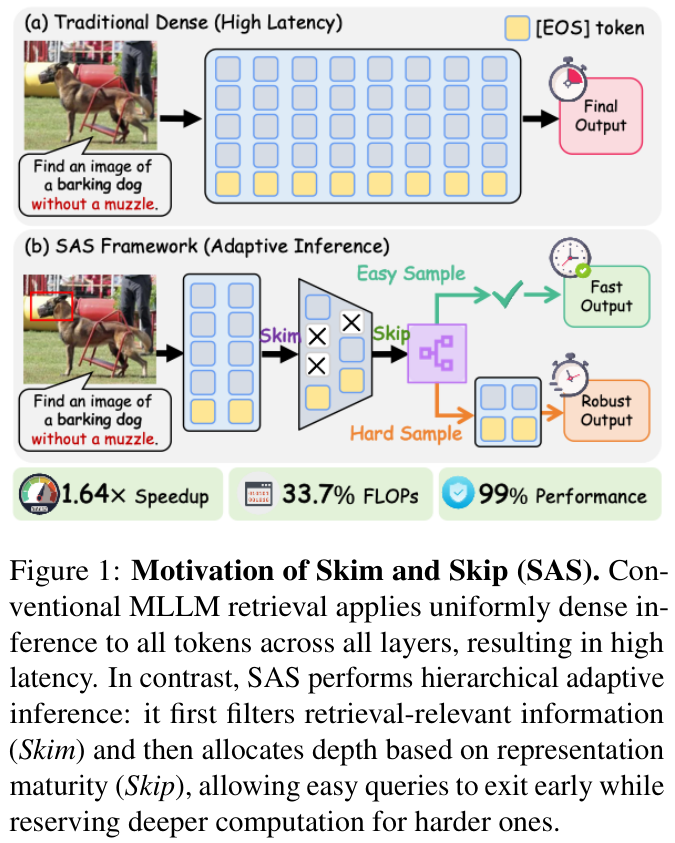
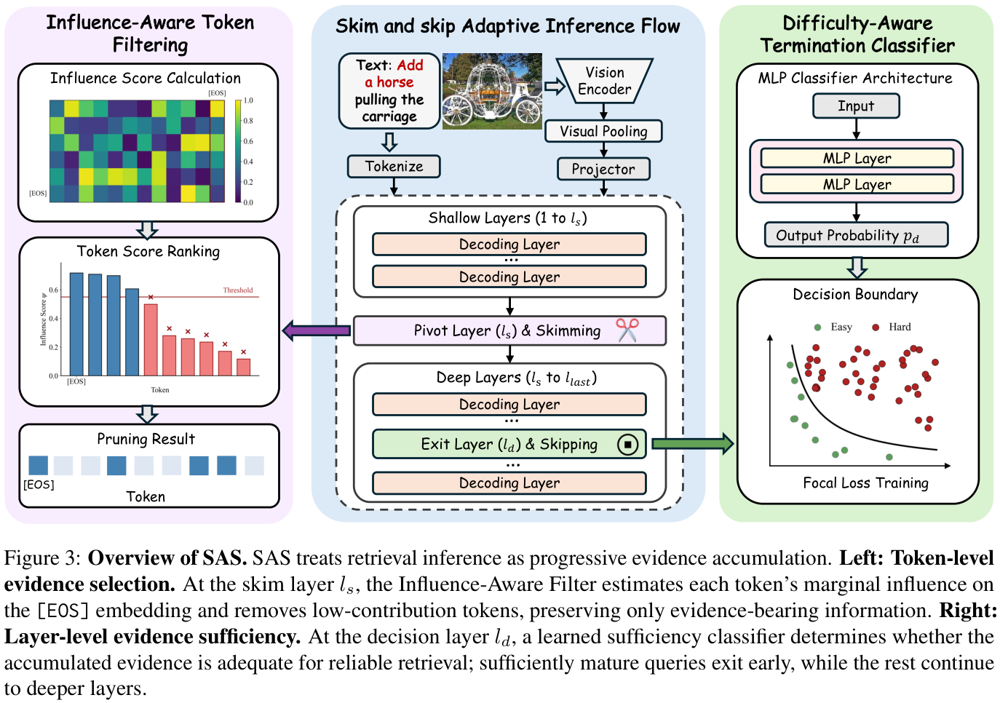
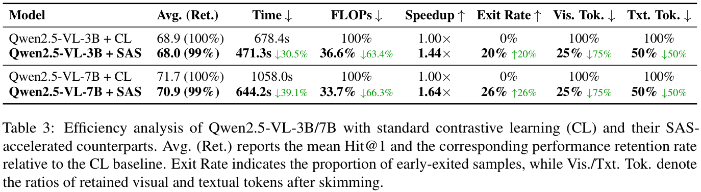
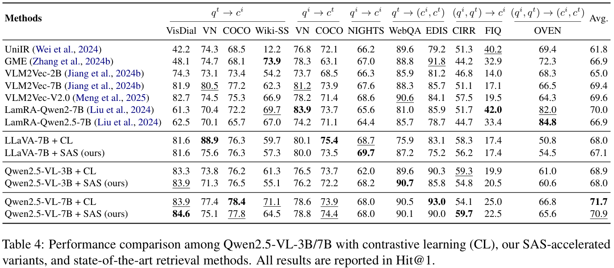

Arxiv地址：[https://arxiv.org/abs/2609.01613](https://arxiv.org/abs/2609.01613)

EMNLP 2026 主会论文：[ACL Anthology](https://aclanthology.org/2026.emnlp-main.1927/)

代码：[https://github.com/GaoMengGladys/SAS](https://github.com/GaoMengGladys/SAS)

## 1. 关键词 (Keywords)

* 通用多模态检索 / Universal Multimodal Retrieval
* 多模态大语言模型 / Multimodal Large Language Models
* 自适应推理 / Adaptive Inference
* 跨模态 Token 筛选 / Cross-modal Token Selection
* 影响感知过滤 / Influence-Aware Filtering
* 自适应深度与提前退出 / Adaptive Depth and Early Exit
* 检索表示 / Retrieval Embedding

## 2. 背景与动机 (Background & Motivation)

多模态大语言模型可以把文本、图像及其组合编码到统一的检索空间，但常见做法需要让所有输入 token 经过全部模型层，再使用最后一层的 `[EOS]` 表示进行匹配。面对长序列和大量查询，这种统一的稠密推理会带来较高成本。

论文从两个角度重新审视这一做法：一方面，不同 token 对最终检索表示的贡献并不相同；另一方面，不同查询所需的处理深度也不同。以 VLM2Vec-V2.0 的分析为例，第 14 层 `[EOS]` 对输入的注意力中，排名前 10 的 token 平均占据 77.8% 的注意力质量；在 MSCOCO 文本到图像检索中，按最终层相似度间隔划分的简单与困难查询，在第 22 层的 Hit@1 分别为 55.0% 和 7.2%。这些观察提示，可以同时考虑**保留哪些信息**和**每个查询需要多少计算深度**。

  

原文 **Figure 1** 展示了这一思路：先筛选信息，再判断当前表示是否足以支持检索，让部分查询提前退出。

## 3. 核心方法 (Core Methodology)

  

原文 **Figure 3** 给出了 Skim and Skip（SAS）的整体流程。方法把检索看作逐层积累证据的过程，依次进行 token 选择和深度分配。

### Skim：以检索表示为中心筛选证据

Skim 首先对视觉编码器输出做 pooling，然后在指定的筛选层评估视觉和文本 token。论文分析删除某个 token 后 `[EOS]` 注意力输出的扰动，构造可在推理时计算的 **influence score**：它综合注意力、隐藏状态以及投影信息，近似衡量该 token 对检索表示的影响。模型按这一统一的跨模态标准排序，移除低分 token，让后续层集中处理保留下来的证据。这个分数并非只看注意力权重，因为 token 的 value 与聚合结果之间的差异也会影响删除后的扰动。

### Skip：依据表示成熟程度决定计算深度

Skip 在决策层判断当前表示是否已足以可靠匹配。由于标准检索模型主要监督最终层表示，论文采用两阶段训练：

1. **激活中间层检索能力**：以最终层表示为教师进行特征蒸馏，同时使用对比学习增强中间表示的检索区分能力，并保留最终层对比目标。
2. **训练退出判断器**：冻结骨干，训练轻量分类器，综合中间检索的 Top-1 相似度、Top-1/Top-2 间隔、模态标识与 `[EOS]` 语义特征，判断查询是否可在决策层退出。未达到退出条件的样本继续经过后续层。

因此，Skim 减少需要继续处理的信息量，Skip 则针对不同样本分配不同计算深度；提前退出依赖经过训练的中间表示和判断器。

## 4. 实验设计 (Experimental Design)

论文在 Qwen2.5-VL-Instruct 3B 和 7B 上实现 SAS，并额外评估 LLaVA 风格架构。评估使用 MMEB 检索划分中的 **12 个基准、五类任务**，以平均 **Hit@1** 衡量检索表现，并在单张 NVIDIA A100 GPU 上测量端到端推理时间。效率对比使用相同设置下训练、未采用自适应加速的对比学习（CL）稠密模型作为基线。

主要配置包括：第 1 层进行视觉 pooling，第 10 层进行影响感知筛选，第 12 层进行退出判断；文本 token 剪枝比例为 50%，同时保留 16-token 下限。Table 3 中 SAS 保留 25% 的视觉 token 和 50% 的文本 token。第一阶段使用 LoRA 在 8 张 H100 上训练；第二阶段在单张 A100 上冻结骨干并训练退出分类器。

## 5. 实验结果与分析 (Results & Analysis)

### 检索性能、计算量与实际时间

  

原文 **Table 3** 同时报告平均检索成绩、LLM 侧 FLOPs 和端到端耗时：

* **Qwen2.5-VL-3B**：平均 Hit@1 从 68.9 降至 68.0，约保持基线性能的 99%；LLM 侧 FLOPs 降低 63.4%，端到端时间从 678.4 秒降至 471.3 秒，即 **1.44×** 加速；20% 的样本提前退出。
* **Qwen2.5-VL-7B**：平均 Hit@1 从 71.7 降至 70.9，约保持基线性能的 99%；LLM 侧 FLOPs 降低 **66.3%**，单张 A100 上端到端时间从 1058.0 秒降至 644.2 秒，即 **1.64×** 加速；26% 的样本提前退出。

这里的 99% 是相对于各自稠密基线的**平均 Hit@1 保持率**，不代表每个任务都保持 99%；FLOPs 降幅也不能直接当作端到端时间降幅。论文指出，原型使用标准稠密注意力内核，可变长度序列带来的 padding 和较小矩阵运算会使实际加速低于理论计算量收益。

### 不同任务上的表现

  

原文 **Table 4** 展示了各任务的差异。以 7B 为例，SAS 在 CIRR 上由 54.1 提升至 59.7，而 Wiki-SS 由 71.1 降至 64.5；因此，整体平均接近基线仍可能伴随单项任务的明显变化。LLaVA-7B 的平均 Hit@1 从 68.0 变为 67.1，说明方法还在另一架构上进行了评估。

### 两级自适应的互补性

在 3B 的组件消融中，仅使用证据筛选时平均 Hit@1 为 68.0、速度为基线的 1.26×；仅使用深度自适应时为 68.1 和 1.17×；组合后为 68.0 和 1.44×（原文 Table 5）。这表明两项机制针对输入宽度和处理深度中的不同计算开销，组合后的收益高于单独使用。

## 6. 总结与贡献 (Conclusion & Contribution)

SAS 将多模态检索中的效率问题拆为两个连续决策：用影响感知评分筛选与最终 `[EOS]` 检索表示相关的跨模态证据，再用经过训练的中间表示和分类器判断是否提前退出。在论文测试的 12 项 MMEB 检索任务上，该方法在平均检索表现接近稠密基线的同时减少语言模型侧计算并改善端到端推理时间。

其证据范围是检索与 embedding 工作负载；论文尚未在视觉问答或字幕生成等生成任务上验证该方法，实际速度收益也会受到内核、序列长度和批处理方式影响。
